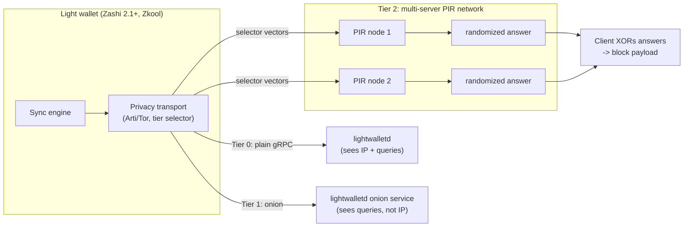

# Technical Whitepaper: Privacy-Preserving Light Client Sync for Zcash

Status: reference design for the ZCG proposal. The PoC in `poc/` implements the
models below against a simulated network; it is not audited production code.

## 1. Threat model

Adversaries:

| Adversary | Capability | Goal |
|-----------|------------|------|
| Sync-server operator | Sees gRPC connections and full request stream from its own server | Link a wallet to IPs and sync patterns |
| Sync-server operator (post-Tor world) | Even when the wallet connects over Tor via Arti, it presents a **stable client onion identity** and its block requests remain visible | Cluster all sync sessions of a wallet over time; profile which blocks it pulls |
| Network observer | Passive listener on the path (ISP, Wi-Fi, AS-level) | Infer that a client is syncing a Zcash wallet and when |
| Colluding minority of PIR servers | Up to k−1 of k servers share their query logs | Learn which blocks a client retrieved |

Out of scope: compromising client devices, global passive traffic-analysis of the
Tor network itself, and consensus-level attacks. The lightwalletd wallet-app threat
model documents the baseline limitations we address.

Assets protected:

- **Client IP address** (identity leak) — largely solved already by the wallets'
  Arti/Tor transports (Zashi 2.1+, Zkool); this design composes with them
- **Sync query pattern** — which compact blocks the wallet downloads (timing /
  interest leak) — **the gap this project closes**

## 2. Architecture

- **Tier 0 (legacy default).** Wallet ↔ lightwalletd directly. Observer + operator
  see IP and every requested block height.
- **Tier 1 (Tor onion sync) — already shipped.** Zashi 2.1 (August 2025, beta)
  tunnels sync through Arti; Zkool (successor to Ywallet) ships native Arti
  support. This hides the IP from the operator and hides sync traffic from path
  observers. What remains: the operator still sees per-wallet query patterns,
  and the wallet's stable client onion identity links its sessions over time.
- **Tier 2 (Tor + multi-server PIR) — this proposal.** The block-index question is
  answered by k ≥ 2 independent PIR nodes, each receiving a randomized selector
  vector. No single node learns which block was requested; the client
  reconstructs the payload by XOR-ing the k answers. PIR composes with the
  wallets' existing Arti transports and removes the last visible signal: the
  block index itself.

## 3. PIR schemes in the PoC

### 3.1 XorPIR (k servers, correctness baseline)

Database: N equal-size blocks B₁…B_N. Client wants block B_i.

1. Client samples k−1 uniform binary vectors v₁,…,v_{k−1} ∈ {0,1}^N and sets
   v_k = v₁ ⊕ … ⊕ v_{k−1} ⊕ e_i (e_i = unit vector at i).
2. Server j answers a_j = ⊕_{t: v_j[t]=1} B_t.
3. Client computes ⊕_j a_j = B_i.

Per-server privacy is information-theoretic: the vector any single server receives
is uniformly random and independent of i. Cost: upload O(kN) bits, download O(|B|).

### 3.2 MatrixPIR (2 servers, bandwidth-optimized)

Database arranged as an r×c matrix of blocks (√N×√N when N is a square; the PoC
pads with zero blocks otherwise). Client wants M[r][c].

1. Client samples uniform s ∈ {0,1}^r, sends selector s to server 2 and s ⊕ e_r to
   server 1.
2. Server j answers f_j = ⊕_{t: sel_j[t]=1} row_t(M) — an element-wise XOR of whole
   rows, c blocks long.
3. f₁ = f₂ ⊕ row_r, so the client XORs the two answers and reads column c.

Each server's selector is uniform regardless of r (one-time-pad argument), so
per-server privacy is again information-theoretic. Cost: upload O(√N) bits,
download O(√N·|B|) — compared with the only non-PIR way to hide the query
outright, downloading the entire chain (O(N·|B|)).

### 3.3 Why this is safe to claim

- The privacy guarantee is **per-server, information-theoretic** — no hardness
  assumptions. Collusion of all k servers breaks it; we document k and the trust
  assumption explicitly rather than overselling.
- Tor protects IPs; PIR protects query content. The tiers compose.
- The PoC tests both correctness and the uniformity property that underlies the
  privacy claim (see `poc/tests/test_pir.py`).

## 4. Bandwidth model

For N blocks of size B and k servers (numbers from `pirlight.metrics.bandwidth_report`):

| Scheme | Upload | Download | Query hidden from servers? |
|--------|--------|----------|-----------------------------|
| Direct fetch (Tier 0/1) | O(log N) | O(B) | n/a (server sees index) |
| Download-everything | O(log N) | O(N·B) | yes |
| XorPIR (k) | O(kN) | O(B) | yes (each server) |
| MatrixPIR (2) | O(√N) | O(√N·B) | yes (each server) |

MatrixPIR wins whenever 2√N·B ≪ N·B, i.e. N > 4; XorPIR wins on download but pays
linear upload. Mainnet parameterization and benchmarks are M1–M2 deliverables.

## 5. Limitations (stated plainly)

1. The PoC **simulates** the network and Tor (no real sockets); it demonstrates the
   cryptographic/metadata structure, not production integration.
2. PIR adds bandwidth and requires ≥2 honest, non-colluding sync nodes — the
   multi-operator infra the ZCG RFP calls for is exactly the deployment answer.
3. Compact-block payloads on mainnet are larger and variable-size; production
   parameters need benchmarking (M1–M2).
4. This design protects sync metadata only; it does not change Zcash's consensus
   or on-chain privacy properties.

## 6. Alignment with upstream

- librustzcash #2665 — "Add a backend-agnostic network-privacy layer": our Tier 1/2
  transport is designed to plug in at that layer.
- zcash-android-wallet-sdk #1741 — "Use new Lightwalletd calls over Tor": Tier 1
  is the minimal, immediately shippable step.
- ZCG RFP — lightwalletd infrastructure maintained by many teams: the PIR node
  network is a natural extension of that multi-operator model.
